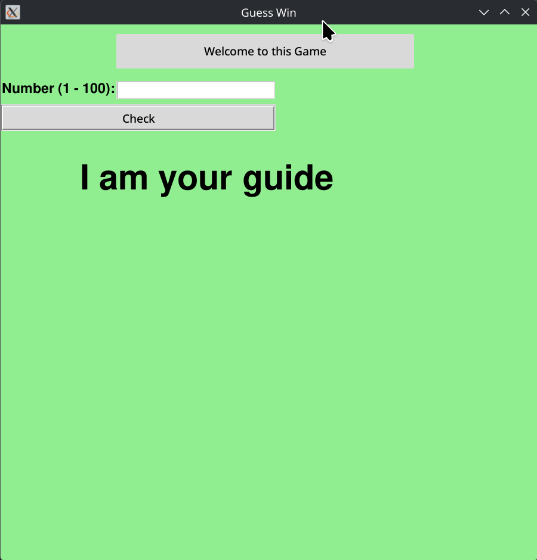

# 🎮 Guess Win

A simple number-guessing game built with **Python** and **Tkinter**.

The game picks a random number between 1 and 100. You type a guess,
and the game tells you if it's too low, too high, or if you've won.

---

## 🚀 How to Run

1. Make sure Python 3.8+ is installed.
2. Clone the repository:
   git clone https://github.com/yasinking1136/guess-win.git
   cd guess-win
3. Run the game:
   python3 main.py

Tkinter comes pre-installed with Python, so no extra dependencies are needed.

---

## ✨ Features

- Random number between 1 and 100
- Live feedback: Too low / Too high / You Win
- Input validation (rejects empty or non-numeric input)
- Clean and simple GUI

---

## 🛠️ Built With

- **Python 3**
- **Tkinter** (standard GUI library)

---

## 📸 Screenshot

---

## 📄 License

This project is licensed under the MIT License — see the [LICENSE](LICENSE) file for details.
